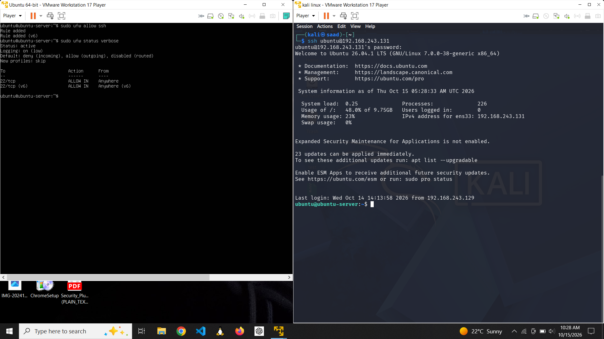
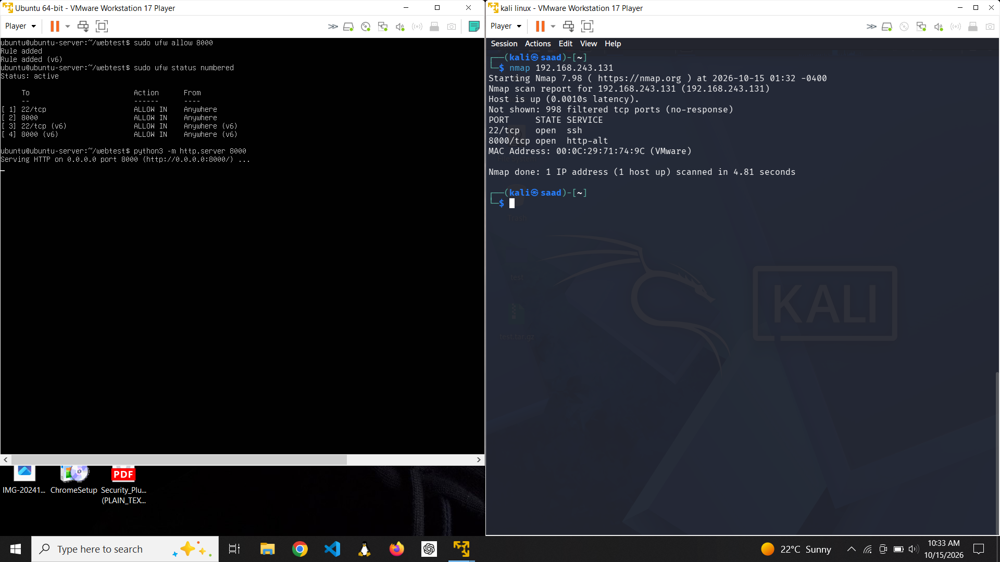
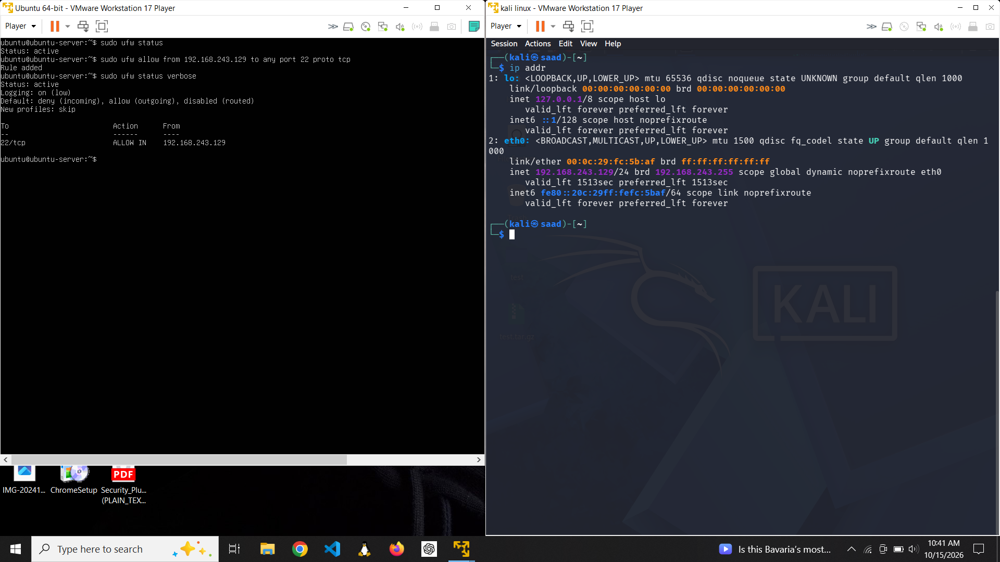

# UFW Firewall Lab: Ubuntu Server and Kali Linux

A hands-on lab demonstrating how to configure and validate **UFW (Uncomplicated Firewall)** on an Ubuntu Server VM, using Kali Linux as the client for connectivity and port-testing exercises.

## Objectives

- Inspect the initial UFW state and enable the host firewall.
- Allow SSH so the server remains reachable for administration.
- Add and test a temporary rule for TCP port `8000`.
- Verify reachable services with Nmap, a Python HTTP server, `curl`, and a browser.
- Remove the temporary test rule and confirm the resulting firewall behavior.
- Restrict SSH access to the Kali client IP as a final hardening exercise.

## Lab environment

| Component | Details |
|---|---|
| Firewall target | Ubuntu Server VM |
| Test client | Kali Linux VM |
| Kali client IP shown in lab | `192.168.243.129` |
| Ubuntu server IP shown in lab | `192.168.243.131` |
| Administration service | SSH / TCP `22` |
| Temporary test service | HTTP test server / TCP `8000` |

> **Note:** These IP addresses belong to the private VM lab network shown in the screenshots. Replace them with your own VM addresses when repeating the exercises.

## Lab workflow

### 1. Check and enable UFW

On Ubuntu Server, inspect the firewall state, set a safe default policy, allow SSH, and enable UFW:

```bash
sudo ufw status verbose
sudo ufw default deny incoming
sudo ufw default allow outgoing
sudo ufw allow OpenSSH
sudo ufw enable
sudo ufw status numbered
```

If you are connected remotely over SSH, ensure the SSH allow rule is in place **before** enabling the firewall so you do not lock yourself out.

### 2. Test connectivity from Kali

Check that the server is reachable and inspect its exposed TCP ports:

```bash
ping -c 4 192.168.243.131
nmap -Pn -sV 192.168.243.131
```

The results depend on the firewall rules and services running at the time of the scan.

### 3. Allow TCP port 8000 for a controlled test

On Ubuntu Server:

```bash
sudo ufw allow 8000/tcp
sudo ufw status numbered
```

Start a temporary HTTP server in a test directory:

```bash
mkdir -p ~/webtest
cd ~/webtest
echo "UFW lab test page" > test.html
python3 -m http.server 8000
```

Keep this process running while testing. From Kali, use the server's address to request the page:

```bash
curl http://192.168.243.131:8000/test.html
```

You can also open `http://192.168.243.131:8000/test.html` in the Kali browser. The screenshots document the HTTP server and browser test.

### 4. Remove the temporary test rule

When the test is complete, remove the port 8000 rule. Use the numbered status output to confirm the rule number before deleting it, because rule numbers can change:

```bash
sudo ufw status numbered
sudo ufw delete allow 8000/tcp
sudo ufw status numbered
```

Repeat the Nmap or HTTP request test to compare behavior after the rule is removed.

### 5. Restrict SSH to the Kali client

For a more restrictive rule, permit SSH only from the Kali VM's private IP:

```bash
sudo ufw allow from 192.168.243.129 to any port 22 proto tcp
sudo ufw status numbered
```

If a broad SSH rule such as `OpenSSH ALLOW IN Anywhere` is still present, remove that broader rule after confirming the source-specific rule works. Use `sudo ufw status numbered` and delete the correct rule by its current number. Be careful not to remove the only working SSH rule during a remote session.

## Screenshots

The `screenshots/` folder contains the lab evidence in chronological order. Two screenshots that displayed `/etc/passwd` output have been replaced with blurred versions to avoid publishing account information. Use these edited files rather than the originals.

## Key takeaways

- UFW provides a straightforward interface for managing host firewall rules.
- Default-deny incoming traffic and explicit allow rules make the intended access easier to reason about.
- A successful scan or HTTP request depends on both firewall policy and whether a service is listening.
- Temporary test rules should be removed after testing.
- Source-restricted rules reduce exposure compared with allowing a service from any address.
- Always verify the active rules after adding, deleting, or changing them.

## Safety and scope

This lab is intended for systems you own or are authorized to test. Keep the HTTP server limited to the isolated lab network, stop it when finished with `Ctrl+C`, and do not expose the test service to untrusted networks.


## Selected evidence

### UFW rules and port testing





### Verify and harden SSH access



All screenshots are available in [`screenshots/`](screenshots/). The two sensitive-output screenshots use the blurred versions, not the original unedited images.
